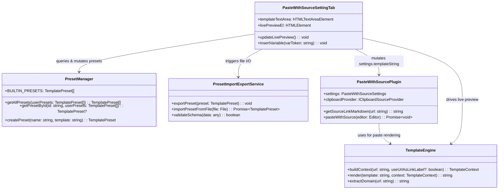
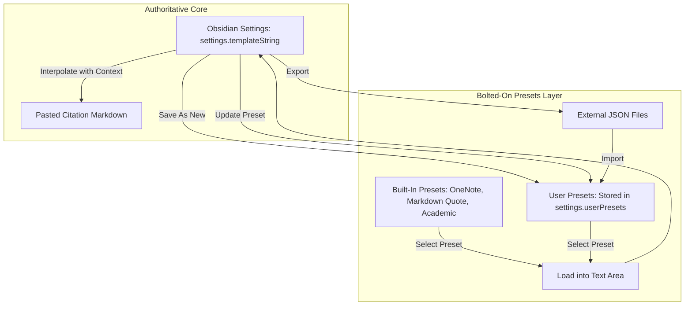
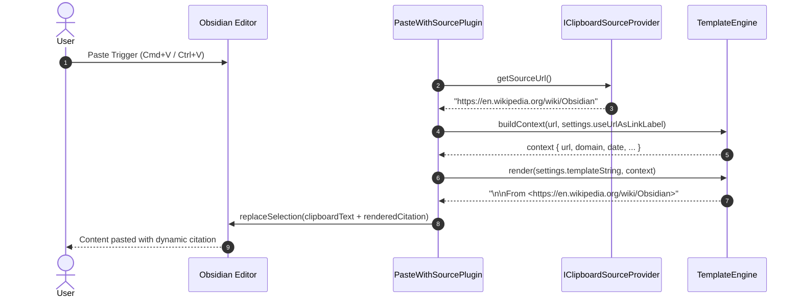
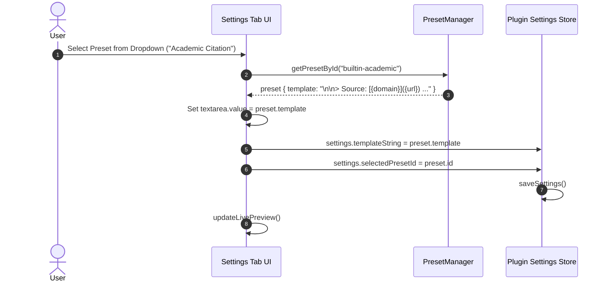
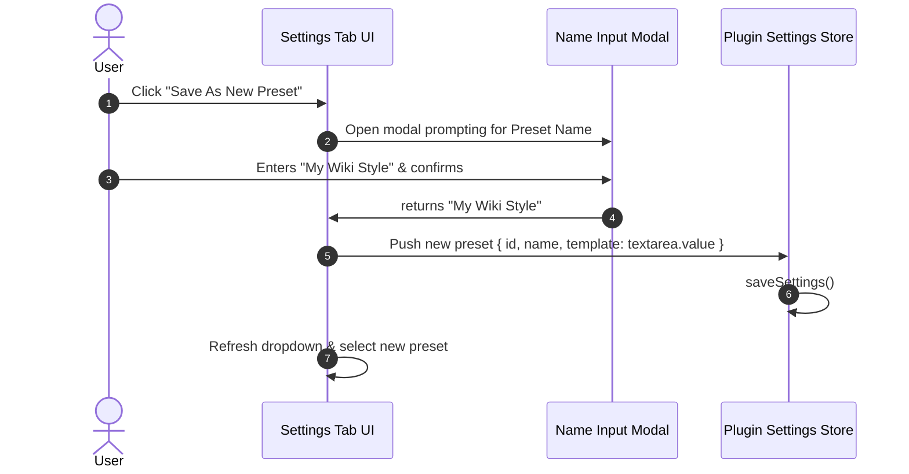
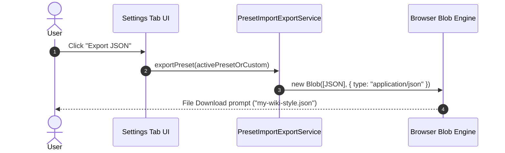

# Technical Design: Link Source Templates

This document details the software architecture, class diagrams, data models, sequence flows, and user interface designs for the **Link Source Templates** feature in **Paste with Source**.

---

## 1. System Architecture

The feature separates concerns into five distinct components:
1. **`TemplateEngine`**: Pure, stateless string interpolator and context builder.
2. **`PresetManager`**: Manages built-in immutable presets and mutable user presets.
3. **`PresetImportExportService`**: Handles JSON serialization, Blob file downloads, and FileReader uploads.
4. **`PasteWithSourcePlugin`**: Core plugin managing lifecycle, keystroke listeners, and clipboard paste actions.
5. **`PasteWithSourceSettingTab`**: Rich UI containing the authoritative textarea, preset toolbar, variable badges, and dynamic live preview.

### Component Relationship



---

## 2. The "Bolted-On" Data Flow

The central design principle is that `settings.templateString` is the sole source of truth for citations. Presets are a convenience layer that read from or write to the text area.



---

## 3. Data Models & Type Definitions

### 3.1 `TemplateContext`
```typescript
export interface TemplateContext {
  /** Full source URL (e.g. "https://en.wikipedia.org/wiki/Obsidian") */
  url: string;
  /** Hostname without www (e.g. "en.wikipedia.org") */
  domain: string;
  /** Page/article name derived from URL path slug */
  page: string;
  /** Raw URL path (e.g. "/wiki/Obsidian") */
  path: string;
  /** Current date: YYYY-MM-DD */
  date: string;
  /** Current 24h time: HH:mm */
  time: string;
  /** Current 12h time: hh:mm A */
  time_12: string;
  /** Combined local datetime: YYYY-MM-DD HH:mm */
  datetime: string;
  /** UTC ISO timestamp: YYYY-MM-DDTHH:mm:ss.sssZ */
  iso: string;
  /** 4-digit year: YYYY */
  year: string;
  /** 2-digit month: MM */
  month: string;
  /** 2-digit day: DD */
  day: string;
  /** Pre-rendered markdown link according to link label settings */
  link: string;
  /** Literal label string "Source" */
  source: string;
}
```

### 3.2 `TemplatePreset`
```typescript
export interface TemplatePreset {
  /** Unique stable ID */
  id: string;
  /** Display title in dropdown */
  name: string;
  /** The template string containing {var} placeholders */
  template: string;
  /** True for built-in system presets */
  isBuiltIn?: boolean;
  /** Optional brief description */
  description?: string;
}
```

### 3.3 Updated `PasteWithSourceSettings`
```typescript
export interface PasteWithSourceSettings {
  interceptPaste: boolean;
  interceptShortcut: "ctrl+v" | "shift+insert" | "both";
  pasteMode: "default+source" | "clipboard+source";
  useUrlAsLinkLabel: boolean;

  /** Authoritative template string evaluated on paste */
  templateString: string;

  /** Last selected preset ID (for UI selection highlight only) */
  selectedPresetId: string;

  /** User-created custom presets */
  userPresets: TemplatePreset[];

  /** Legacy attribute preserved for backward compatibility */
  citationStyle?: "OneNote" | "Source";
}
```

---

## 4. Class Implementations

### 4.1 `TemplateEngine`

```typescript
export class TemplateEngine {
  /**
   * Constructs a populated context object from a source URL and system time.
   */
  static buildContext(url: string, useUrlAsLinkLabel: boolean = true): TemplateContext {
    const now = new Date();
    const domain = this.extractDomain(url);
    const link = useUrlAsLinkLabel
      ? `[${url}](${url})`
      : `[Source](${url})`;

    const pad = (n: number) => n.toString().padStart(2, "0");
    const year = now.getFullYear().toString();
    const month = pad(now.getMonth() + 1);
    const day = pad(now.getDate());
    const date = `${year}-${month}-${day}`;
    const time = `${pad(now.getHours())}:${pad(now.getMinutes())}`;

    // 12-hour calculation
    const hours12 = now.getHours() % 12 || 12;
    const ampm = now.getHours() >= 12 ? "PM" : "AM";
    const time_12 = `${pad(hours12)}:${pad(now.getMinutes())} ${ampm}`;

    return {
      url,
      domain,
      page: this.extractPage(url),
      path: this.extractPath(url),
      date,
      time,
      time_12,
      datetime: `${date} ${time}`,
      iso: now.toISOString(),
      year,
      month,
      day,
      link,
      source: "Source",
    };
  }

  /**
   * Replaces all {var} tokens in the template with contextual values.
   */
  static render(template: string, context: TemplateContext): string {
    if (!template) return "";

    // Parse literal \n and \t escape sequences if present
    let processed = template.replace(/\\n/g, "\n").replace(/\\t/g, "\t");

    // Replace {variable} case-insensitively
    return processed.replace(/\{([a-zA-Z0-9_]+)\}/g, (match, key) => {
      const lowerKey = key.toLowerCase();
      if (lowerKey in context) {
        return (context as any)[lowerKey];
      }
      // Return unmatched tokens unaltered
      return match;
    });
  }

  /**
   * Extracts clean hostname from URL without leading www.
   */
  static extractDomain(urlStr: string): string {
    try {
      const parsed = new URL(urlStr);
      return parsed.hostname.replace(/^www\./i, "");
    } catch {
      return urlStr.replace(/^https?:\/\//i, "").split("/")[0].replace(/^www\./i, "");
    }
  }
}
```

### 4.2 `PresetManager`

```typescript
export class PresetManager {
  static readonly BUILTIN_PRESETS: TemplatePreset[] = [
    {
      id: "builtin-onenote",
      name: "OneNote Style",
      template: "\n\nFrom <{link}>",
      isBuiltIn: true,
      description: "Classic Microsoft OneNote format (From <url>)",
    },
    {
      id: "builtin-italic-attribution",
      name: "Italic Attribution",
      template: "\n\n— *Source: [{page}]({url})*",
      isBuiltIn: true,
      description: "Editorial dash attribution with italicized page link",
    },
    {
      id: "builtin-minimal-domain",
      name: "Minimal Domain",
      template: "\n\nSource: [{domain}]({url})",
      isBuiltIn: true,
      description: "Clean, unobtrusive source link using the domain name",
    },
    {
      id: "builtin-parenthetical",
      name: "Parenthetical",
      template: "\n\n(Source: [{page}]({url}))",
      isBuiltIn: true,
      description: "Casual parenthetical citation with page link",
    },
    {
      id: "builtin-academic",
      name: "Academic Citation",
      template: "\n\nSource: [{page}]({url}) via {domain} (Accessed: {date})",
      isBuiltIn: true,
      description: "Comprehensive citation with page, domain, and access date",
    },
    {
      id: "builtin-obsidian-callout",
      name: "Obsidian Callout",
      template: "\n\n> [!info] Source: [{page}]({url})\n> Accessed on {date}",
      isBuiltIn: true,
      description: "Styled Obsidian info callout box with access date",
    },
    {
      id: "builtin-markdown-quote",
      name: "Markdown Quote",
      template: "\n\n> — [Source]({url})",
      isBuiltIn: true,
      description: "Blockquoted source link (> — [Source](url))",
    },
    {
      id: "builtin-raw-url",
      name: "Raw URL",
      template: "\n\n{url}",
      isBuiltIn: true,
      description: "Plain origin URL without markdown link markup",
    },
  ];

  static getAllPresets(userPresets: TemplatePreset[] = []): TemplatePreset[] {
    return [...this.BUILTIN_PRESETS, ...userPresets];
  }

  static getPresetById(id: string, userPresets: TemplatePreset[] = []): TemplatePreset | undefined {
    return this.getAllPresets(userPresets).find((p) => p.id === id);
  }
}
```

### 4.3 `PresetImportExportService`

```typescript
export class PresetImportExportService {
  static exportPreset(preset: TemplatePreset): void {
    const payload = {
      $schema: "https://paste-with-source.obsidian.md/schemas/preset-v1.json",
      format: "paste-with-source-preset",
      version: 1,
      name: preset.name,
      description: preset.description || "",
      template: preset.template,
      createdAt: new Date().toISOString(),
    };

    const jsonStr = JSON.stringify(payload, null, 2);
    const blob = new Blob([jsonStr], { type: "application/json" });
    const url = URL.createObjectURL(blob);

    const a = document.createElement("a");
    const safeName = preset.name.toLowerCase().replace(/[^a-z0-9_-]+/g, "-");
    a.href = url;
    a.download = `${safeName || "preset"}.json`;
    document.body.appendChild(a);
    a.click();
    document.body.removeChild(a);
    URL.revokeObjectURL(url);
  }

  static async importPresetFromFile(file: File): Promise<TemplatePreset> {
    const text = await file.text();
    let data: any;
    try {
      data = JSON.parse(text);
    } catch {
      throw new Error("Selected file is not valid JSON.");
    }

    if (!data || typeof data.template !== "string" || !data.template.trim()) {
      throw new Error("Invalid preset format: missing or empty 'template' property.");
    }

    const name = (typeof data.name === "string" && data.name.trim())
      ? data.name.trim()
      : file.name.replace(/\.json$/i, "");

    return {
      id: `user-preset-${Date.now()}-${Math.random().toString(36).substr(2, 5)}`,
      name,
      template: data.template,
      description: typeof data.description === "string" ? data.description : "",
      isBuiltIn: false,
    };
  }
}
```

---

## 5. Sequence Flows

### 5.1 Sequence 1: Paste Event Interpolation



### 5.2 Sequence 2: Applying a Preset to the Text Box



### 5.3 Sequence 3: Saving a New Preset from the Text Box



### 5.4 Sequence 4: Exporting a Preset to JSON



### 5.5 Sequence 5: Importing a Preset from JSON

```mermaid
sequenceDiagram
    autonumber
    actor User
    participant UI as Settings Tab UI
    participant Importer as PresetImportExportService
    participant Settings as Plugin Settings Store

    User->>UI: Click "Import JSON"
    UI->>UI: Trigger hidden file input `<input type="file">`
    User->>UI: Selects "custom-citation.json"
    UI->>Importer: importPresetFromFile(file)
    Importer-->>UI: validated preset object
    UI->>Settings: settings.userPresets.push(preset)
    UI->>Settings: settings.templateString = preset.template
    UI->>Settings: settings.selectedPresetId = preset.id
    Settings->>Settings: saveSettings()
    UI->>UI: Refresh dropdown, populate textarea & update preview
    UI-->>User: Notice("Imported preset successfully")
```



---

## 6. User Interface Layout: Settings Tab

The settings interface organizes the template workflow logically from top to bottom:

```text
+-------------------------------------------------------------------------+
| Paste with Source Settings                                              |
|                                                                         |
| Intercept Paste          [Toggle: ON]                                   |
| Intercept Shortcut       [Dropdown: Both Ctrl+V and Shift+Insert]       |
| Paste Mode               [Dropdown: Default handler + source]           |
| Use URL as Link Label    [Toggle: ON]                                   |
|                                                                         |
| ─────────────────────────────────────────────────────────────────────── |
| 📋 Citation Template & Presets                                          |
|                                                                         |
| Template Preset:         [Dropdown: Academic Citation ▾]                |
| Actions:                 [+ Save New] [✎ Update] [🗑 Delete]            |
|                          [⤓ Export JSON] [⤒ Import JSON]                |
|                                                                         |
| Citation Template (Authoritative):                                      |
| +---------------------------------------------------------------------+ |
| | \n\n> Source: [{domain}]({url}) (Accessed: {date})                  | |
| |                                                                     | |
| +---------------------------------------------------------------------+ |
| Click to insert variable:                                               |
| [{url}] [{domain}] [{page}] [{path}] [{date}] [{time}] [{datetime}] [{link}] |
|                                                                         |
| 👁️ Live Preview:                                                       |
| +---------------------------------------------------------------------+ |
| | > Source: [en.wikipedia.org](https://en.wikipedia.org/...)           | |
| | (Accessed: 2026-09-11)                                              | |
| +---------------------------------------------------------------------+ |
+-------------------------------------------------------------------------+
```

---

## 7. Error Handling & Guardrails

1. **Immutable Built-Ins**:
   - The UI disables or hides "Update Preset" and "Delete Preset" buttons whenever `isBuiltIn` is true on the selected preset.
2. **Schema Validation on Import**:
   - `PresetImportExportService` verifies that imported JSON has a valid `template` string. If invalid, a descriptive `Notice` is shown to the user without crashing the settings tab.
3. **Graceful Variable Fallbacks**:
   - If a URL cannot be parsed by `new URL()`, `extractDomain()` uses regex to extract the hostname safely.
   - Unknown `{tokens}` are left as literal strings, preventing template corruption.
