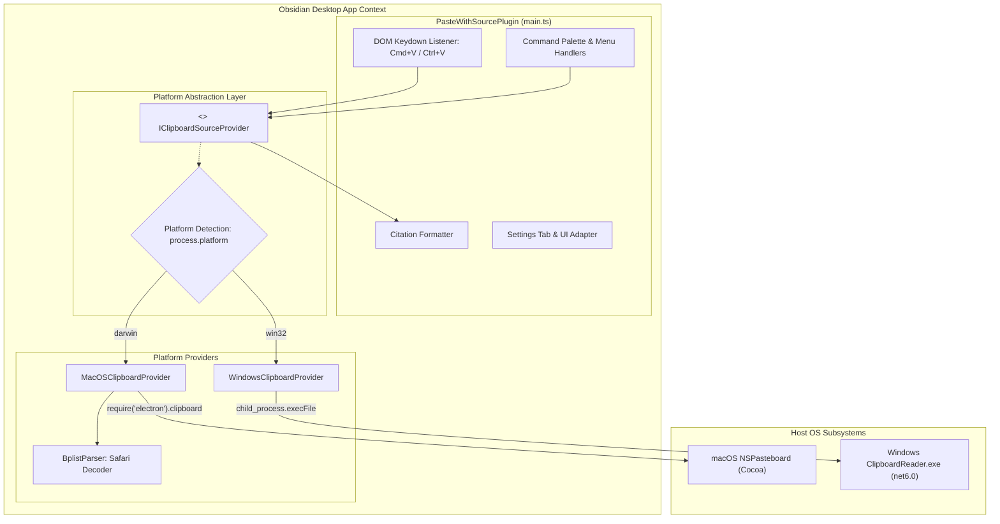
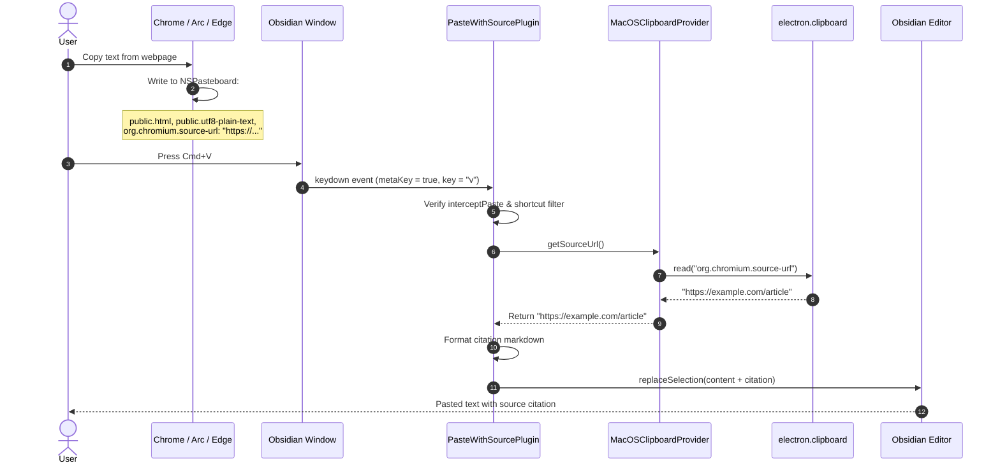
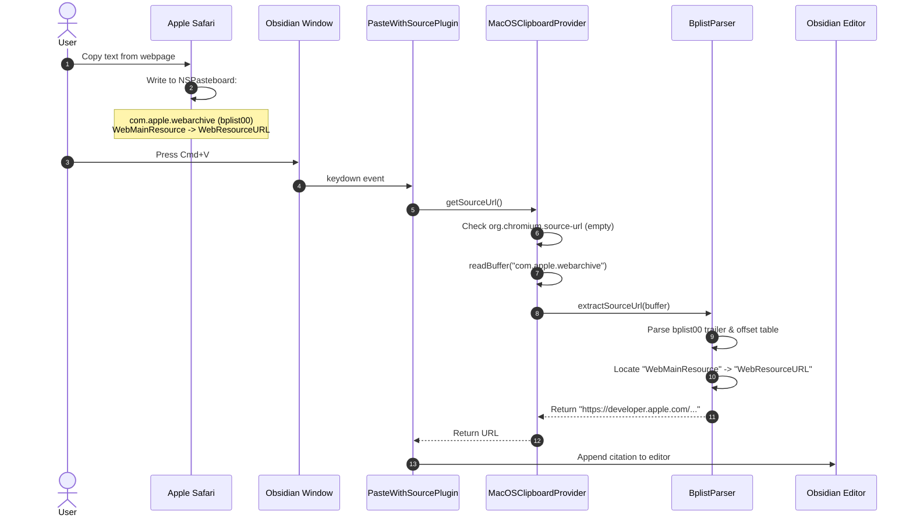

# Architecture & Design: macOS Support Feature

This document details the architectural design, component abstractions, sequence flows, binary decoding algorithms, and user interface adaptations for adding native macOS support to the **Paste with Source** Obsidian plugin.

---

## 1. Architectural Overview & Design Philosophy

The core architectural evolution is transitioning from a Windows-only subprocess execution model to a **Platform Provider Pattern**. This enables in-process execution on macOS via Obsidian's embedded Electron APIs while maintaining 100% backward compatibility with the existing Windows C# companion utility.

### Key Design Principles
1. **Zero External Binaries on macOS**: Bypass macOS Gatekeeper, code signing, notarization, and architecture splits (`arm64` vs `x86_64`) by using in-process Electron APIs (`require('electron').clipboard`).
2. **Sub-Millisecond Execution**: In-process clipboard reads eliminate child-process spawn latency on macOS.
3. **Pluggable Multi-Platform Architecture**: Decouple the editor paste interceptor and citation formatter from platform-specific clipboard retrieval via a clean provider interface.
4. **Zero-Dependency Binary Plist Decoding**: Parse Apple's `com.apple.webarchive` format in pure TypeScript using Node.js `Buffer`.

---

## 2. High-Level Component Architecture



---

## 3. Class & Interface Definitions

### 3.1 Provider Interface (`IClipboardSourceProvider`)
```typescript
export interface IClipboardSourceProvider {
  /**
   * Asynchronously inspects the system clipboard for a source web URL.
   * Resolves to the valid URL string (starting with http), or empty string if not found.
   */
  getSourceUrl(): Promise<string>;
}
```

### 3.2 macOS Implementation (`MacOSClipboardProvider`)
```typescript
export class MacOSClipboardProvider implements IClipboardSourceProvider {
  async getSourceUrl(): Promise<string> {
    try {
      const { clipboard } = require("electron");

      // 1. Check Chromium family (Chrome, Edge, Brave, Arc, Opera)
      const chromiumUrl = clipboard.read("org.chromium.source-url");
      if (chromiumUrl && chromiumUrl.trim().startsWith("http")) {
        return chromiumUrl.trim();
      }

      // 2. Check Safari / WebKit family (Apple WebArchive)
      const webArchiveBuf: Buffer = clipboard.readBuffer("com.apple.webarchive");
      if (webArchiveBuf && webArchiveBuf.length > 8) {
        const safariUrl = BplistParser.extractSourceUrl(webArchiveBuf);
        if (safariUrl && safariUrl.trim().startsWith("http")) {
          return safariUrl.trim();
        }
      }

      // 3. Fallback: Check public.url (hyperlinks)
      const publicUrl = clipboard.read("public.url");
      if (publicUrl && publicUrl.trim().startsWith("http")) {
        return publicUrl.trim();
      }
    } catch (error) {
      console.warn("PasteWithSource: Error reading macOS clipboard:", error);
    }
    return "";
  }
}
```

### 3.3 Windows Implementation (`WindowsClipboardProvider`)
Encapsulates the existing Windows logic:
```typescript
export class WindowsClipboardProvider implements IClipboardSourceProvider {
  constructor(private pluginDir: string) {}

  async getSourceUrl(): Promise<string> {
    return new Promise((resolve) => {
      (process as any).noAsar = true;
      const exePath = path.join(this.pluginDir, "ClipboardReader.exe");
      execFile(exePath, [], (error, stdout, stderr) => {
        if (error) {
          resolve("");
          return;
        }
        const sourceUrl = typeof stdout === "string" ? stdout.trim() : "";
        resolve(sourceUrl.startsWith("http") ? sourceUrl : "");
      });
    });
  }
}
```

---

## 4. Sequence Flows

### 4.1 Sequence 1: macOS Chromium Copy-Paste Flow (Chrome / Edge / Arc)



---

### 4.2 Sequence 2: macOS Safari Copy-Paste Flow (`com.apple.webarchive`)



---

## 5. Binary Property List (`bplist00`) Parsing Specification

The `com.apple.webarchive` pasteboard flavor is serialized as an Apple Binary Property List version 0.0.

### 5.1 Structure Overview
```
+------------------------------------------------------------------------+
| Bytes 0..7   | Magic Header: "bplist00"                                |
+------------------------------------------------------------------------+
| Bytes 8..M   | Object Table (Strings, Dictionaries, Arrays, etc.)      |
+------------------------------------------------------------------------+
| Bytes M..N   | Offset Table (Pointers to each object in Object Table)  |
+------------------------------------------------------------------------+
| Bytes N..N+32| 32-Byte Trailer:                                        |
|              | - [0..5]   unused                                       |
|              | - [6]      offsetIntSize (1, 2, 4, or 8 bytes)          |
|              | - [7]      objectRefSize (1, 2, 4, or 8 bytes)          |
|              | - [8..15]  numObjects (uint64 Big Endian)               |
|              | - [16..23] topObject / rootIndex (uint64 Big Endian)    |
|              | - [24..31] offsetTableOffset (uint64 Big Endian)        |
+------------------------------------------------------------------------+
```

### 5.2 Fast In-Memory Parser Implementation (`BplistParser`)
Rather than relying on heavy third-party npm packages, a dedicated ~80-line parser handles `bplist00` dictionary traversal:

```typescript
export class BplistParser {
  static extractSourceUrl(buf: Buffer): string {
    try {
      if (buf.length < 40) return "";
      if (buf.subarray(0, 8).toString("ascii") !== "bplist00") return "";

      const trailerOffset = buf.length - 32;
      const offsetIntSize = buf.readUInt8(trailerOffset + 6);
      const objectRefSize = buf.readUInt8(trailerOffset + 7);
      const numObjects = Number(buf.readBigUInt64BE(trailerOffset + 8));
      const topObject = Number(buf.readBigUInt64BE(trailerOffset + 16));
      const offsetTableOffset = Number(buf.readBigUInt64BE(trailerOffset + 24));

      const getOffset = (objIndex: number): number => {
        const ptr = offsetTableOffset + objIndex * offsetIntSize;
        if (offsetIntSize === 1) return buf.readUInt8(ptr);
        if (offsetIntSize === 2) return buf.readUInt16BE(ptr);
        if (offsetIntSize === 4) return buf.readUInt32BE(ptr);
        return Number(buf.readBigUInt64BE(ptr));
      };

      const parseObject = (objIndex: number): any => {
        const offset = getOffset(objIndex);
        const marker = buf.readUInt8(offset);
        const objType = marker & 0xf0;
        let count = marker & 0x0f;
        let dataStart = offset + 1;

        // ASCII String
        if (objType === 0x50) {
          if (count === 0x0f) {
            // Count stored in following integer
            const intMarker = buf.readUInt8(dataStart);
            const intBytes = 1 << (intMarker & 0x0f);
            dataStart += 1;
            count = intBytes === 1 ? buf.readUInt8(dataStart) : buf.readUInt16BE(dataStart);
            dataStart += intBytes;
          }
          return buf.subarray(dataStart, dataStart + count).toString("ascii");
        }

        // Dictionary
        if (objType === 0xd0) {
          if (count === 0x0f) {
            const intMarker = buf.readUInt8(dataStart);
            const intBytes = 1 << (intMarker & 0x0f);
            dataStart += 1;
            count = intBytes === 1 ? buf.readUInt8(dataStart) : buf.readUInt16BE(dataStart);
            dataStart += intBytes;
          }
          const dict: Record<string, any> = {};
          const keysStart = dataStart;
          const valsStart = dataStart + count * objectRefSize;

          const readRef = (pos: number) => {
            if (objectRefSize === 1) return buf.readUInt8(pos);
            if (objectRefSize === 2) return buf.readUInt16BE(pos);
            return buf.readUInt32BE(pos);
          };

          for (let i = 0; i < count; i++) {
            const keyIndex = readRef(keysStart + i * objectRefSize);
            const valIndex = readRef(valsStart + i * objectRefSize);
            const key = parseObject(keyIndex);
            // Optimization: Only parse values if key matches target
            if (key === "WebMainResource" || key === "WebResourceURL") {
              dict[key] = parseObject(valIndex);
            }
          }
          return dict;
        }

        return null;
      };

      const root = parseObject(topObject);
      if (root?.WebMainResource?.WebResourceURL) {
        return String(root.WebMainResource.WebResourceURL);
      }
    } catch (e) {
      console.warn("PasteWithSource: bplist parse error:", e);
    }
    return "";
  }
}
```

---

## 6. Keyboard Shortcut & UI Platform Adaptation

### 6.1 Keyboard Interception Logic
```typescript
const isMac = process.platform === "darwin";
const isPasteShortcut = isMac
  ? event.metaKey && event.key.toLowerCase() === "v"
  : (event.ctrlKey && event.key.toLowerCase() === "v") || (event.shiftKey && event.key === "Insert");
```

### 6.2 Settings UI Adaptation
When rendering `PasteWithSourceSettingTab` on macOS:
- Shortcut description: `"Choose which keyboard shortcut(s) to intercept (Cmd+V on macOS)"`.
- Option `"both"`: `"Both Cmd+V and Shift+Insert"` (or `"Cmd+V"` on macOS).
- Option `"ctrl+v"` displayed dynamically as `"Cmd+V only"` on macOS and `"Ctrl+V only"` on Windows.

---

## 7. Security, Sandboxing, and Manifest Configuration

- **Manifest Declaration**: Adding `"isDesktopOnly": true` to `manifest.json` ensures full compatibility with Obsidian's Community Plugin guidelines when utilizing Node.js / Electron APIs.
- **Sandboxing**: `require('electron').clipboard` executes entirely in-process within Obsidian's authorized desktop sandbox, producing zero Gatekeeper alerts or quarantine flags.
