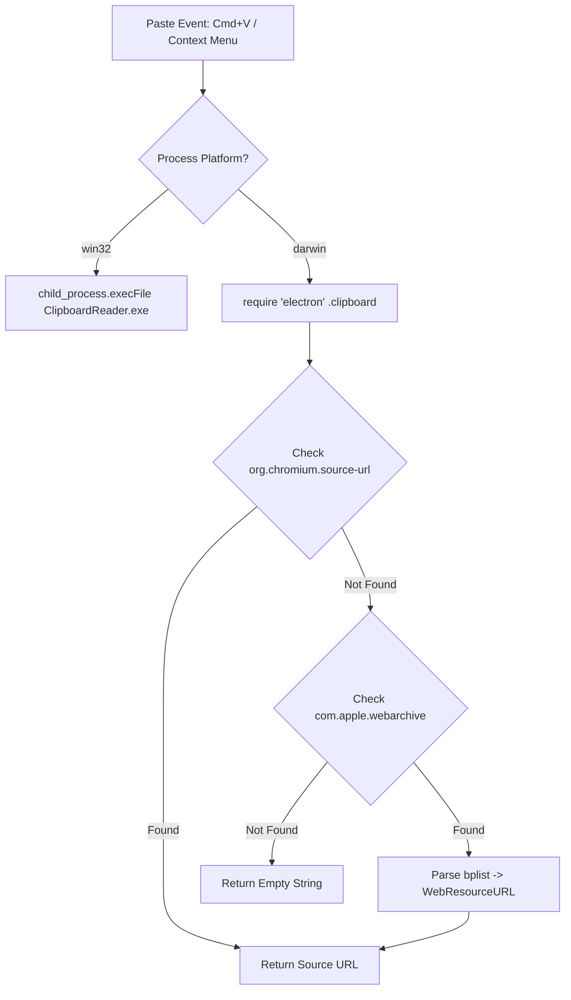

# macOS Support Feasibility Analysis: Paste with Source

**Document Version:** 1.0.0  
**Target Project:** `paste-with-source` (Obsidian Plugin)  
**Status:** Feasible (High Confidence)  

---

## 1. Executive Summary

The **Paste with Source** plugin is currently constrained to Windows because it relies on a compiled C# binary ([`ClipboardReader.exe`](../../ClipboardReader/Program.cs)) targeting `net6.0-windows` to parse the Windows-specific registered clipboard format `CF_HTML`.

**Feasibility Verdict: Highly Feasible.**  
Adding macOS support is not only technically viable, but can be accomplished **without requiring a native compiled binary on macOS**, eliminating Gatekeeper, code signing, notarization, and architecture incompatibility issues (Apple Silicon vs. Intel).

### Key Findings
1. **Chromium Browsers on macOS (Google Chrome, Microsoft Edge, Brave, Arc, Opera)** natively write an origin metadata pasteboard type to `NSPasteboard`: **`org.chromium.source-url`**.
2. **Apple Safari (WebKit)** writes **`com.apple.webarchive`** to `NSPasteboard`. This data structure is a standard Apple binary property list (`bplist00`) containing the key path `WebMainResource -> WebResourceURL`.
3. **Obsidian's Electron Host Environment** exposes the full Node.js and Electron APIs on desktop, including `require('electron').clipboard`, which can directly query custom pasteboard types (`clipboard.read('org.chromium.source-url')`) and buffers (`clipboard.readBuffer('com.apple.webarchive')`) in-process.
4. **Keystroke Interception on macOS is Already Written**: In [`main.ts`](../../main.ts#L82-L87), `Cmd+V` detection via `navigator.platform.includes("MAC")` and `event.metaKey` is already implemented.

---

## 2. Technical Gap Analysis: Windows vs. macOS

| Architectural Dimension | Current Windows Implementation | macOS Target Reality |
| :--- | :--- | :--- |
| **Clipboard Subsystem** | Win32 Clipboard (`CF_HTML`) | macOS `NSPasteboard` (`general`) |
| **Origin Metadata Field** | `SourceURL: <url>` within HTML header | **Chromium:** `org.chromium.source-url`<br>**Safari:** `com.apple.webarchive` (`WebResourceURL`) |
| **Access Mechanism** | Child process (`execFile` -> `ClipboardReader.exe`) | **Option A (Recommended):** In-process `require('electron').clipboard`<br>**Option B:** Swift CLI helper (`ClipboardReader-mac`) |
| **Process Overhead** | 20ms - 60ms subprocess spawn latency | **0ms (In-process)** with Option A; ~30ms with Option B |
| **Binary Distribution** | Bundled `.exe` | **None needed** (Option A) |
| **OS Security / Sandboxing**| Unsigned `.exe` in vault directory | Gatekeeper blocks unsigned binaries; Option A bypasses this entirely |
| **Obsidian Settings / Keydown**| `Ctrl+V` and `Shift+Insert` | `Cmd+V` (already partially present in `main.ts`) |

---

## 3. macOS Browser Clipboard Internals

When a user copies rich text from a web browser on macOS, the browser places multiple representations ("pasteboard flavors") onto the `NSPasteboard.general` pasteboard.

### 3.1 Chromium Family (Chrome, Edge, Brave, Arc, Vivaldi, Opera)
- **Primary Type**: `org.chromium.source-url`
- **Data Format**: UTF-8 plain string containing the canonical web URL.
- **Payload Example**: `https://en.wikipedia.org/wiki/Obsidian_(software)`
- **Electron Reading Method**:
  ```typescript
  const { clipboard } = require("electron");
  const sourceUrl = clipboard.read("org.chromium.source-url");
  ```

### 3.2 WebKit Family (Safari)
- **Primary Type**: `com.apple.webarchive` (Uniform Type Identifier: `com.apple.webarchive` / `Apple Web Archive pasteboard type`)
- **Data Format**: Apple Binary Property List (`bplist00`).
- **Internal Structure**:
  ```text
  {
    "WebMainResource": {
      "WebResourceData": <NSData>,
      "WebResourceFrameName": "",
      "WebResourceMIMEType": "text/html",
      "WebResourceTextEncodingName": "UTF-8",
      "WebResourceURL": "https://developer.apple.com/documentation/"
    }
  }
  ```
- **Extraction**:
  Reading the raw buffer using `clipboard.readBuffer("com.apple.webarchive")` and parsing the `WebResourceURL` key from the binary plist dictionary.

### 3.3 Mozilla Firefox
- **Behavior**: Firefox on macOS does not attach source URL metadata to general text selections on `NSPasteboard` (only for explicit image copies or link copies).
- **Fallback**: For Firefox users, the source URL can either be obtained via a lightweight AppleScript query targeting the active window of Firefox or fall back gracefully to standard paste without errors.

---

## 4. Architectural Implementation Options

### Option 1: In-Process Electron Clipboard API (Recommended)

Instead of compiling a native executable for macOS, the plugin leverages Obsidian's embedded Electron environment.



#### Advantages
1. **Zero Binary Overhead**: No need to compile, package, or distribute a macOS executable.
2. **Instant Universal Compatibility**: Runs identically on Apple Silicon (M1/M2/M3/M4) and Intel x86_64 without dual-architecture compilation.
3. **No Gatekeeper / Code Signing Friction**: Bypasses macOS Gatekeeper quarantine (`com.apple.quarantine`), notarization requirements, and permission dialogs.
4. **Near-Zero Latency**: Eliminates the 20–60ms child process invocation latency, making `Cmd+V` feel instantaneous.

#### Implementation Blueprint
```typescript
import { Platform } from "obsidian";

async function getMacSourceUrl(): Promise<string> {
  try {
    const { clipboard } = require("electron");

    // 1. Check Chromium-based browsers
    const chromiumUrl = clipboard.read("org.chromium.source-url");
    if (chromiumUrl && chromiumUrl.startsWith("http")) {
      return chromiumUrl.trim();
    }

    // 2. Check Safari (Apple WebArchive)
    const webArchiveBuf = clipboard.readBuffer("com.apple.webarchive");
    if (webArchiveBuf && webArchiveBuf.length > 0) {
      const url = extractUrlFromWebArchive(webArchiveBuf);
      if (url && url.startsWith("http")) {
        return url.trim();
      }
    }

    // 3. Fallback: public.url
    const publicUrl = clipboard.read("public.url");
    if (publicUrl && publicUrl.startsWith("http")) {
      return publicUrl.trim();
    }
  } catch (err) {
    console.error("Failed to read macOS pasteboard:", err);
  }
  return "";
}
```

---

### Option 2: Standalone Native Swift CLI Helper (`ClipboardReader-mac`)

Similar to the Windows `.exe`, a native CLI compiled with Swift:

```swift
import Cocoa

let pb = NSPasteboard.general

// 1. Check Chromium
if let url = pb.string(forType: NSPasteboard.PasteboardType("org.chromium.source-url")), !url.isEmpty {
    print(url)
    exit(0)
}

// 2. Check Safari WebArchive
if let data = pb.data(forType: NSPasteboard.PasteboardType("com.apple.webarchive")) {
    if let plist = try? PropertyListSerialization.propertyList(from: data, options: [], format: nil) as? [String: Any],
       let main = plist["WebMainResource"] as? [String: Any],
       let url = main["WebResourceURL"] as? String {
        print(url)
        exit(0)
    }
}

exit(1)
```

#### Evaluation
- **Pros**: Uses Apple's native `PropertyListSerialization`.
- **Cons**: Requires building a Universal 2 binary (`lipo -create`), requires codesigning/notarization to avoid Gatekeeper blocking, and requires `chmod +x` permissions upon deployment. Option 1 is strictly superior.

---

### Option 3: AppleScript / JXA Fallback (`osascript`)

If a browser (such as Firefox) does not record the URL on `NSPasteboard`, an AppleScript fallback can inspect the frontmost application:

```applescript
tell application "System Events"
    set frontApp to name of first application process whose frontmost is true
end tell

if frontApp is "Firefox" then
    tell application "Firefox" to return URL of active tab of front window
else if frontApp is "Safari" then
    tell application "Safari" to return URL of front document
end if
```

#### Evaluation
- **Pros**: Can recover URLs for browsers that do not store metadata on the pasteboard.
- **Cons**: High latency (100ms+), triggers macOS "Automation Permission" security prompts in System Settings, and fails if the user has already switched focus away from the browser. Recommended only as an optional advanced setting.

---

## 5. Required Changes in the Existing Codebase

### 5.1 [`manifest.json`](../../manifest.json)
- Add `"isDesktopOnly": true` (required when accessing `require('electron')`).

### 5.2 [`main.ts`](../../main.ts)
- Refactor `getClipboardSourceUrl()` to branch based on `process.platform`:
  - If `process.platform === "win32"`: Execute `ClipboardReader.exe`.
  - If `process.platform === "darwin"`: Execute in-process Electron clipboard reader.
  - If other: Return empty string.
- Update keyboard shortcut interceptor:
  - Add Mac-specific shortcut option (`Cmd+V`) in `InterceptShortcut` setting type (`"cmd+v"` / `"ctrl+v"`).

### 5.3 Build & Packaging ([`build.ts`](../../build.ts))
- Include lightweight binary plist parsing capability (or bundle a zero-dependency 50-line JS bplist reader).
- Ensure `build.ts` runs on macOS environments where `dotnet` might not be installed (skip `.exe` compilation if not on Windows).

---

## 6. Effort & Implementation Roadmap

| Phase | Description | Estimated Effort |
| :--- | :--- | :--- |
| **Phase 1: Electron Reader Prototype** | Implement in-process `org.chromium.source-url` reading for Chrome, Brave, Arc, Edge on macOS. | 0.5 Day |
| **Phase 2: Safari WebArchive Parser** | Integrate a zero-dependency binary plist reader to parse `WebResourceURL` from `com.apple.webarchive`. | 0.5 Day |
| **Phase 3: Cross-Platform Refactor** | Refactor `main.ts` into a platform-agnostic `ClipboardSourceService`. Update `manifest.json` with `isDesktopOnly: true`. | 0.5 Day |
| **Phase 4: Multi-OS Verification** | Test on macOS (Apple Silicon + Intel) across Chrome, Safari, Edge, Arc. Verify Windows regression safety. | 0.5 Day |
| **Total** | | **2.0 Days** |

---

## 7. Conclusion

Adding macOS support to **Paste with Source** is **fully feasible and highly practical**. By utilizing Electron's in-process clipboard access for `org.chromium.source-url` and `com.apple.webarchive`, the plugin can deliver native macOS compatibility across all major browsers with **zero native binary compilation**, zero Gatekeeper complications, and sub-millisecond execution performance.
