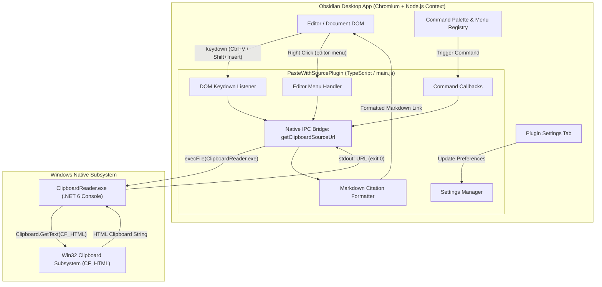
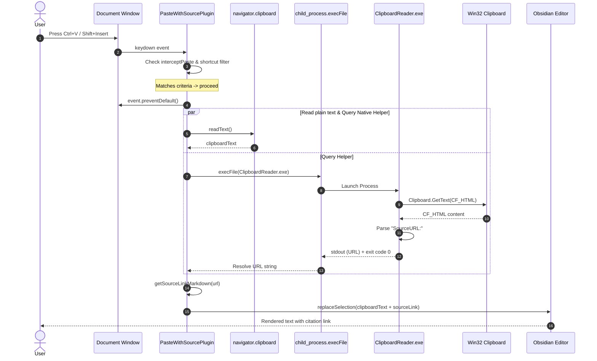
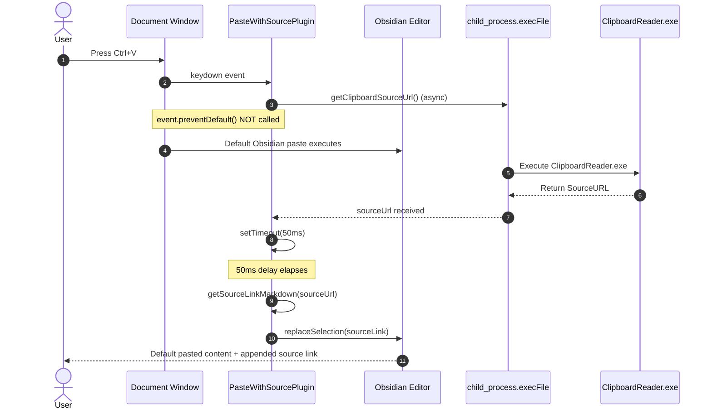

# Architecture & System Design: Paste with Source

This document describes the architectural design, system boundaries, component interactions, sequence flows, and design trade-offs of the **Paste with Source** Obsidian plugin.

---

## 1. High-Level Architecture

The system operates as a hybrid architecture uniting an Electron-based application layer with a native Windows platform helper.



---

## 2. Component Breakdown

### 2.1 `PasteWithSourcePlugin` ([`main.ts`](../../main.ts))
The core orchestrator subclassing `obsidian.Plugin`:
- **Lifecycle Management**: Implements `onload()` to initialize settings, register commands, bind DOM event listeners, and register context menu items.
- **Event Interception**:
  - Monitors the document `keydown` event on the capture/bubble phase.
  - Determines if the pressed key combinations match configured shortcuts (`Ctrl+V`, `Cmd+V`, or `Shift+Insert`).
  - Depending on `pasteMode`, either prevents the default paste event and injects synthesized content, or waits for Obsidian's default handler to complete before appending citation markdown.
- **Command Palette Integration**:
  - `paste-default-plus-source`: Triggers default paste behavior plus citation.
  - `paste-with-source-url`: Directly reads plain text from `navigator.clipboard` and appends citation.
- **Context Menu Integration**: Adds custom menu items to the Obsidian `editor-menu`.

### 2.2 `PasteWithSourceSettingTab` ([`main.ts`](../../main.ts#L194-L274))
Extends `obsidian.PluginSettingTab`:
- Provides an intuitive configuration UI in Obsidian's Settings view.
- Binds reactive UI inputs to plugin settings properties.
- Persists user preferences into `<vault>/.obsidian/plugins/paste-with-source/data.json` via `saveSettings()`.

### 2.3 Native Helper: `ClipboardReader.exe` ([`ClipboardReader/Program.cs`](../../ClipboardReader/Program.cs))
A standalone C# console application compiled for `net6.0-windows`:
- Configured with `[STAThread]` to initialize a single-threaded apartment required for OLE/COM clipboard access.
- Calls `System.Windows.Forms.Clipboard.GetText(TextDataFormat.Html)`.
- Scans line-by-line using `System.IO.StringReader` for the header entry starting with `SourceURL:`.
- Emits the extracted URL to standard output with exit code `0`, or writes error information to stdout/stderr with exit code `1`.

### 2.4 Citation & Link Formatter
Pure functional formatting logic embedded within `PasteWithSourcePlugin`:
- `formatSourceLink(url: string)`:
  - If `useUrlAsLinkLabel === true`: `[${url}](${url})`
  - If `useUrlAsLinkLabel === false`: `[Source](${url})`
- `getSourceLinkMarkdown(url: string)`:
  - If `citationStyle === "OneNote"`: `\n\nFrom <${formattedLink}>`
  - If `citationStyle === "Source"`: `\n\n> — ${formattedLink}`

### 2.5 Build & Deployment Automation
- [`build.ts`](../../build.ts): Synchronously executes TypeScript transpilation (`tsc`) and .NET release compilation (`dotnet build`), staging outputs into the plugin root.
- [`deploy.ts`](../../deploy.ts): Copies distribution assets from `dist/` into a designated Obsidian vault plugin folder.

---

## 3. Deep Dive: Windows Clipboard HTML Format (`CF_HTML`)

When copying rich web content from Chromium browsers (Google Chrome, Microsoft Edge, Brave, Opera) or Firefox on Windows, the browser places content into the Windows clipboard under multiple standard and registered clipboard formats:
- `CF_TEXT` / `CF_UNICODETEXT`: Plain text version.
- `CF_DIB` / `CF_BITMAP`: Rendered raster graphics if images were copied.
- `CF_HTML`: Registered format identifier for rich HTML content with MIME-style headers.

### CF_HTML Header Structure
The format adheres to Microsoft's HTML Clipboard specification:
```http
Version:0.9
StartHTML:0000000105
EndHTML:0000000780
StartFragment:0000000141
EndFragment:0000000744
SourceURL:https://en.wikipedia.org/wiki/Obsidian_(software)
<html>
<body>
<!--StartFragment-->Obsidian is a personal knowledge base...<!--EndFragment-->
</body>
</html>
```

### Extraction Logic in `Program.cs`
1. Access clipboard:
   ```csharp
   string html = Clipboard.GetText(TextDataFormat.Html);
   ```
2. Stream lines:
   ```csharp
   using (var sr = new StringReader(html)) {
       string line;
       while ((line = sr.ReadLine()) != null) {
           if (line.StartsWith("SourceURL:")) {
               Console.WriteLine(line.Substring("SourceURL:".Length));
               Environment.Exit(0);
           }
       }
   }
   ```

---

## 4. Interaction & Sequence Flows

### 4.1 Sequence 1: Paste Interception with `pasteMode = "clipboard+source"`

In this mode, the plugin intercepts the keystroke, suppresses the default editor handling, reads plain text from `navigator.clipboard`, fetches the source URL via `ClipboardReader.exe`, formats the combined string, and replaces the editor selection.



---

### 4.2 Sequence 2: Paste Interception with `pasteMode = "default+source"`

In default mode, the native Obsidian paste event is permitted to run so that rich markdown/HTML formatting converts normally. A timed asynchronous task (50ms) appends the source citation immediately following the default paste.



---

## 5. Inter-Process Communication (IPC) & Electron Architecture

### 5.1 Resolving Binary Location
Obsidian plugins reside in `<vault>/.obsidian/plugins/<plugin-id>/`. The plugin dynamically locates `ClipboardReader.exe` at runtime using the vault's adapter:
```typescript
const adapter = this.app.vault.adapter;
const basePath = (adapter instanceof FileSystemAdapter) ? adapter.getBasePath() : "";
const exePath = path.join(
  basePath,
  ".obsidian",
  "plugins",
  "paste-with-source",
  "ClipboardReader.exe"
);
```

### 5.2 Electron ASAR Archive Bypass
Electron packages application code into `.asar` archive files. Spawning external binaries can fail if Electron attempts to resolve paths within an ASAR virtual filesystem. The plugin explicitly sets:
```typescript
(process as any).noAsar = true;
```
This guarantees that Node's native `child_process.execFile` directly accesses the host OS filesystem path.

### 5.3 Process Lifecycle & Error Handling
- The executable runs without arguments (`[]`).
- If execution errors or returns a non-zero exit code:
  - Error details are logged to `console.error`.
  - The promise resolves safely to `""` (empty string), preventing editor crashes.
- If stdout returns text:
  - Whitespace is trimmed.
  - The URL is validated to verify it begins with `"http"`.
  - If valid, the URL is resolved; otherwise, resolved as `""`.

---

## 6. State Management & Persistence

### 6.1 Settings Data Contract
```typescript
interface PasteWithSourceSettings {
  interceptPaste: boolean;
  interceptShortcut: "ctrl+v" | "shift+insert" | "both";
  pasteMode: "default+source" | "clipboard+source";
  citationStyle: "OneNote" | "Source";
  useUrlAsLinkLabel: boolean;
}
```

### 6.2 Default Settings
```typescript
const DEFAULT_SETTINGS: PasteWithSourceSettings = {
  interceptPaste: true,
  interceptShortcut: "both",
  pasteMode: "default+source",
  citationStyle: "OneNote",
  useUrlAsLinkLabel: true,
};
```

### 6.3 Serialization Lifecycle
- **Loading**: During `onload()`, `this.loadSettings()` executes `Object.assign({}, DEFAULT_SETTINGS, await this.loadData())`.
- **Saving**: Whenever settings are toggled in `PasteWithSourceSettingTab`, `this.plugin.saveSettings()` calls `this.saveData(this.settings)`, updating `data.json`.

---

## 7. Architectural Decisions, Trade-offs & Limitations

### 7.1 Separate Native Binary vs. Native Node Addon (C++ / Rust)
- **Decision**: Standalone C# .NET console executable invoked via `execFile`.
- **Pros**:
  - Extremely easy to build with standard `dotnet build`.
  - Avoids native Node.js ABI / `node-gyp` recompilation issues across different Electron / Node versions inside Obsidian.
  - Does not crash the Obsidian host process if memory violations occur in clipboard reading.
- **Cons**:
  - Process creation overhead (~15ms to 50ms per paste) compared to in-process FFI.
  - Requires .NET runtime on the host machine.

### 7.2 Delay-Based (`50ms`) Default Paste Handling
- **Decision**: In `default+source` mode, allow the default paste event to finish, then append citation after 50 milliseconds.
- **Trade-off**: Simple and non-invasive, but introduces a heuristic timing dependency. On heavily loaded systems, if the default paste takes longer than 50ms, the cursor position or selection state might interleave unpredictably.

### 7.3 Windows Exclusivity
- **Decision**: Built specifically around Win32 `CF_HTML` and `net6.0-windows`.
- **Limitation**: The plugin does not function on macOS, Linux, or mobile devices. On non-Windows platforms, `execFile` fails and falls back cleanly without appending citations.
